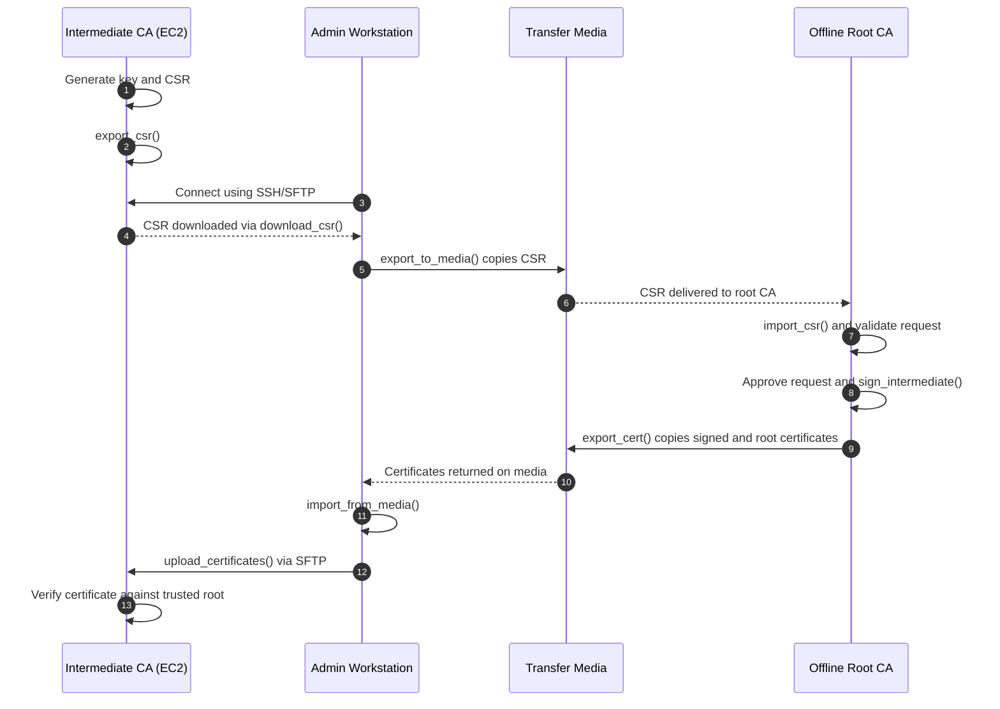

# PKI Automation

A Python/OpenSSL project demonstrating a three-component public key infrastructure (PKI): an **offline root certificate authority (CA)**, **intermediate CAs hosted on AWS EC2**, and a **Windows administrative workstation** coordinating certificate issuance.

## Repository structure

```text
pki-2/
├── offline_root_ca/       # Offline root CA setup and signing operations
├── intermediate_ca/       # Intermediate CA setup and operations on EC2
├── admin_workstation/     # CSR and certificate transfer orchestration
├── .gitignore
└── README.md
```

The repository contains **source code and documentation only**. Private keys, generated certificates, CSRs, CA databases, credentials, and operational state should be stored separately and not committed to Git.

## Components

### 1. Offline Root CA (Ubuntu VM)

- Acts as the PKI trust anchor and keeps the root CA private key under offline control.
- Imports intermediate CA certificate signing requests (CSRs), validates and approves requests, and signs intermediate CA certificates.
- Exports signed intermediate CA certificates and the public root CA certificate to approved transfer media.
- Python operations include `import_csr()`, `sign_intermediate()`, and `export_cert()`.

### 2. Intermediate CA (AWS EC2)

- Generates its private key and CSR, then makes the CSR available for retrieval.
- Receives the signed intermediate CA certificate and the root CA public certificate.
- Verifies the returned certificate against the trusted root certificate before enabling CA operations.
- Python operations include `export_csr()` and certificate verification.

### 3. Admin Workstation (Windows)

- Coordinates file transfers between the EC2 intermediate CA and the offline root CA.
- Uses SSH/SFTP (Paramiko) to download CSRs from EC2 and upload signed certificates to EC2.
- Uses controlled file copying to and from removable transfer media.
- Python operations include `download_csr()`, `export_to_media()`, `import_from_media()`, and `upload_certificates()`.

## Intermediate CA certificate issuance: round-trip workflow



**Files transferred:**

- **CSR to root CA:** `intermediateCA1.csr`
- **Certificates back to intermediate CA:** `intermediateCA1.crt` and `rootCA.crt`

On the intermediate CA, a basic chain verification command is:

```bash
openssl verify -purpose any -CAfile certs/rootCA.crt certs/intermediateCA1.crt
```

The root CA private key **never leaves the offline root CA**. The root certificate is public; it must nevertheless be authenticated as the intended trust anchor, rather than trusted solely because it arrived through the transfer workflow.

## Development vs. production isolation

In the current lab, a **VMware shared folder** simulates transfer media between the admin workstation and the root CA VM. This is convenient for testing, but it does **not** provide genuine offline isolation. In a production-style deployment, the root CA would remain disconnected from networks, and files would move through controlled removable media with integrity checks, request approval, and audit logging.

## Development Roadmap

- [x] Offline Root CA setup and certificate issuance
- [x] Root CA certificate revocation and CRL generation
- [x] Intermediate CA issuance of end-entity certificates (TLS server certificates)
- [x] Post-quantum and crypto-agile PKI support
- [x] Certificate revocation lifecycle and CRL distribution
- [x] HSM integration for root CA private-key protection (SoftHSM prototype)
- [x] Moving intermediate CA CSR signing workflow (EC2 → Admin Workstation → Offline Root CA → Admin Workstation → EC2)
- [ ] Planned — Certificate inventory and lifecycle tracking


